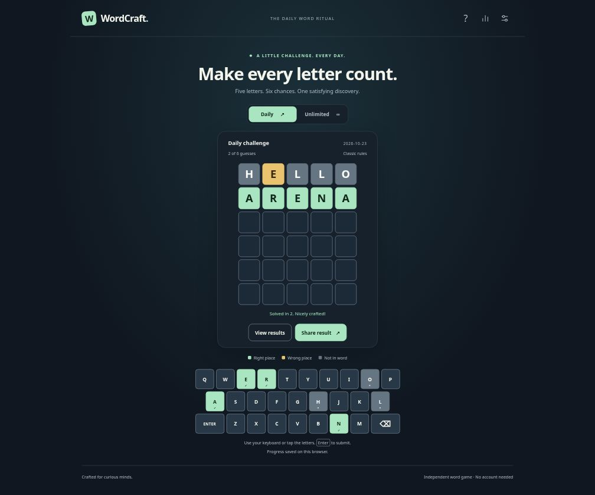
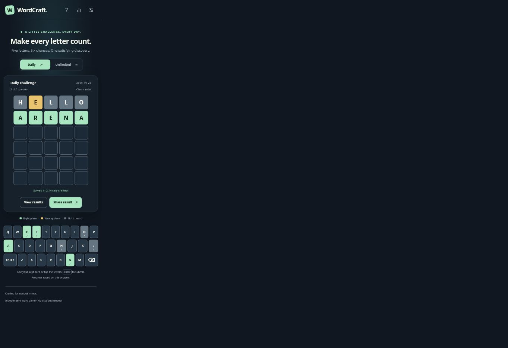

# WordCraft

An independent five-letter word puzzle built with HTML5, CSS3 and vanilla JavaScript. Six attempts, shared UTC daily puzzles and unlimited practice, with original branding and no frontend build process.

All six development phases are complete. [Play WordCraft](https://wordcraft-mu-one.vercel.app/) or browse the [source repository](https://github.com/awaljanhematyar/wordcraft). The game is published as a static website on Vercel. See [final report](PHASE_6_REPORT.md), [handoff guide](HANDOFF.md) and [portfolio case study](PORTFOLIO_CASE_STUDY.md).

## Features

- Daily puzzle from a stable, versioned UTC schedule. Refresh preserves accepted guesses and typed input. Startup, focus, visibility, timer and pre-submit checks recognize a new day.
- Unlimited randomized practice with New Game and no immediate answer repetition where possible. Abandoned games do not count as losses.
- Hard Mode enforces revealed positions, yellow exclusions and inferred duplicate-letter minimum/maximum counts. Activate before the first accepted guess. Disabling removes that puzzle's Hard Mode eligibility.
- Accurate duplicate-letter scoring, six-attempt termination, physical/on-screen QWERTY keyboards, clue precedence and animation input locking.
- Separate Daily/Unlimited games, wins, win percentage, current/best streak and guess distribution.
- Persistent dark/light themes, optional synthesized audio, settings and game progress.
- Emoji sharing with mode, puzzle identity and eligible Hard Mode marker. No guessed words or answer appear in copied results. A selected readonly field supports manual copy when Clipboard API access fails.
- Keyboard-accessible controls, named feedback, modal focus handling, polite announcements and reduced-motion support.

## Stack and installation

HTML5, CSS3, JavaScript ES6+, native ES modules, Local Storage and optional Web Audio. No React, Tailwind, Bootstrap, backend, runtime packages, analytics, external fonts or frontend compilation. Node.js is only for automated testing.

Extract the ZIP and open its wordcraft directory, or clone the approved repository after publication. No package installation is required. Serve the directory over HTTP because ES modules do not reliably work with file:// URLs.

If Python is installed:

```sh
cd wordcraft
python3 -m http.server 8080
```

On Windows, `py -m http.server 8080` is equivalent. Open http://localhost:8080. Any static HTTP server or editor HTTP preview is suitable. Python is a local convenience, not a production service.

## Architecture and structure

| Path | Responsibility |
| --- | --- |
| index.html | Semantic shell, metadata, controls and dialogs |
| css/style.css | Dark/light tokens, responsive layout, motion and focus |
| js/main.js | Controller, bootstrap, persistence and UTC lifecycle |
| js/game.js, hard-mode.js | Pure scoring, validation and accumulated clues |
| js/daily.js, daily-answers-v1.js | Immutable UTC daily schedule |
| js/unlimited.js | Random answer selection and puzzle identity |
| js/storage.js, statistics.js | Validated state, ledger, reconciliation and per-mode statistics |
| js/ui.js, interactions.js, dialogs.js, dom.js | Rendering, shared input, modal focus and efficient writes |
| js/settings.js, share.js | Preferences, synthesized sound and private emoji sharing |
| js/words.js, assets/ | Licensed dictionary, curated answers, provenance and favicon |
| tests/ | Node tests, repeatable browser fixtures and actual QA records |
| screenshots/ | Actual browser captures and capture-method documentation |

Detailed APIs, schema and merge rules: [ARCHITECTURE.md](ARCHITECTURE.md). Word data has 11,846 allowed guesses and 821 separate curated answers. Keep the frozen daily-v1 snapshot and mappings stable across releases.

Storage key: `wordcraft:state`, schema 1. Restoration validates identities/types/words, replays guesses and rebuilds statistics from completion records. Corrupted/unavailable storage recovers without crashing. To reset, remove only this key using the browser's site-storage tools. This clears that browser's progress, preferences and statistics.

## Testing

Node.js 20+ is required for tests. Node v24.19.0 executed the final checks. From the project root:

```sh
node --test
node --test --experimental-test-coverage --test-coverage-include='**/js/**'
```

`npm test` is an optional equivalent. No npm install is needed. Final result: 258 passed, zero failed/skipped. All 258 approved Phase 5 tests remain unchanged. Executed-module coverage: 100% lines, 96.78% branches, 97.35% functions. [Actual output](tests/PHASE_6_RESULTS.txt) and [test guide](tests/README.md).

## Browser and accessibility evidence

Actual Linux Chromium checks report Chrome/155.0.0.0 via reduced user agent. Full build unavailable. Phase 6 rechecked physical scoring, repeated Enter, invalid words, refresh, mode progress, statistics and sharing fallback. HTTP returned 200 with HTML, JavaScript and CSS MIME types, and native module gameplay worked. [Final browser evidence](tests/PHASE_6_BROWSER.json) and [HTTP records](tests/PHASE_6_HTTP.json).

Phase 5 measured 120 responsive cases at 320, 375, 390, 768, 1024 and 1440 CSS px, across both themes, landscape, long messages and doubled text including dialogs. No horizontal overflow was measured. Phase 6 rechecked 1440 and 390px frames with 30 tiles and 28 keys. These are actual Chromium layouts, not physical mobile-device testing.

Keyboard input, modal initial focus, Tab containment, Escape and focus return were exercised. Controls/tiles have readable labels, validation uses a polite live region, and feedback uses symbols/state text as well as color. Tested text pairs meet 4.5:1 and empty tile/key boundaries meet 3:1. Reduced-motion CSS and injected preference behavior pass tests. The smallest narrow-screen keyboard key is about 25×46px, below the preferred 44px width.

Firefox/WebKit, physical touch devices, spoken screen-reader output, OS reduced motion, real 200% browser zoom, audible output and successful Clipboard API permission over eventual HTTPS hosting remain unverified. This is not accessibility certification. See [browser QA](tests/BROWSER_QA.md).

## Performance

Phase 5 local unthrottled observations: optimized FCP 68ms, load end 79.9ms and CLS 0. The optimized sample used warm cache. It is not a controlled cold-load comparison or field score. Entering HELLO produced 15 mutation records versus 930 before optimization. Geometry reservations prevent the observed shift, unchanged DOM writes are skipped and dictionary module-preload starts the existing cached request early.

Production source totals: JS 143,014 bytes, CSS 12,545 bytes, HTML 9,268 bytes. JS includes the 77,166-byte dictionary. These sources are unchanged in Phase 6. See tests/PHASE_5_PERFORMANCE.json for actual samples and tests/PHASE_5_SOURCE_AUDIT.json for per-file sizes.

## Screenshots and portfolio material

Actual completed-game captures, not mockups. The app used 1440×1200 desktop and 390×1200 mobile CSS viewports inside a Chromium capture fixture, displayed at 70% scale. Raw mobile output includes surrounding fixture background. No physical phone was used. See [capture details](screenshots/README.md).





[Case study and project descriptions](PORTFOLIO_CASE_STUDY.md) are ready for review. They have not been published to the portfolio.

## Deployment readiness

[DEPLOYMENT.md](DEPLOYMENT.md) contains the approval-gated GitHub/Vercel steps and live verification checklist. Vercel configuration selects Other (`framework: null`), empty install/build commands and output directory `.`. There is no production Node process. `.vercelignore` keeps QA fixtures, screenshots and internal reports out of the deployment while the source ZIP retains them.

Configured headers include CSP, nosniff, Referrer-Policy, frame denial and disabled camera/microphone/geolocation. These were source-reviewed. The internal HTTP preview does not apply vercel.json headers. Actual HTTPS headers, MIME types and clipboard permission must be checked after approved deployment. Canonical/og:url and an absolute social-image URL need the approved origin. No guessed live URL is included.

## Licensing

Original source, visual assets and documentation: all rights reserved pending the owner's selected license or client agreement. Editable source does not imply an open-source grant or copyright transfer. See [LICENSE.md](LICENSE.md).

Word data: Wordnik open-source wordlist, revision `46e6215d0f90356afe9c8ba4be347e7e98cb425c`, MIT, Copyright (c) 2020 Wordnik. Keep [full license](assets/WORDNIK_LICENSE.txt) with redistributed data. [Third-party notices](THIRD_PARTY_NOTICES.md), [provenance](assets/WORD_LIST_PROVENANCE.md) and [checksums](assets/WORD_LIST_MANIFEST.json) document its scope. No proprietary Wordle branding/assets or answer list were used.

## Known limitations

Answers and future daily schedules are inspectable. Device clocks and Local Storage can be changed. Statistics belong to the current browser/origin and can disappear when storage is cleared or unavailable. Storage has quota limits and no atomic cross-tab transactions. Reconciliation is best effort, not synchronized multiplayer. There are no accounts, server-side security, anti-cheat, leaderboards or cross-device synchronization. The finite dictionary contains uncommon/regional words and is not universal. No runtime network dictionary is required, but no service worker/offline installation is promised.
